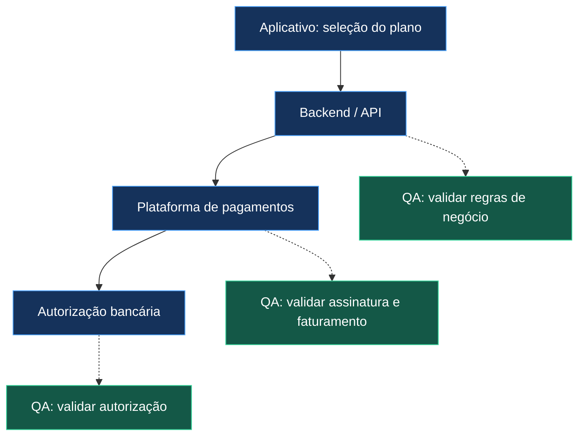

# 🏗️ Fluxograma — Assinaturas e Pagamentos Recorrentes

## Visão geral

Este diagrama representa um fluxo conceitual de pagamentos recorrentes, utilizado para demonstrar pontos de verificação em Quality Assurance.

A representação é ilustrativa e não descreve a arquitetura de produção de uma empresa específica.

## Fluxo da aplicação

## 🔍 Pontos de validação

### 1. Aplicativo

- O plano apresentado corresponde à opção selecionada?
- A periodicidade está clara para o usuário?
- As condições de contratação estão corretas?

### 2. Backend e API

- O plano foi identificado corretamente?
- A periodicidade foi enviada conforme a regra de negócio?
- Os erros de integração são tratados adequadamente?

### 3. Plataforma de pagamentos

- A assinatura foi criada com o intervalo esperado?
- A próxima fatura respeita o ciclo contratado?
- O pagamento está associado à assinatura correta?

### 4. Autorização bancária

- A frequência autorizada é compatível com o produto?
- As condições e os limites foram apresentados corretamente?
- Existem divergências entre a autorização e o faturamento?

## ⚠️ Considerações importantes

A confirmação da periodicidade de uma assinatura não comprova, isoladamente, a configuração correta de uma autorização bancária.

A validação completa exige analisar os componentes envolvidos e as regras aplicáveis ao meio de pagamento.

---

> Diagrama conceitual desenvolvido para fins educacionais e de portfólio.
